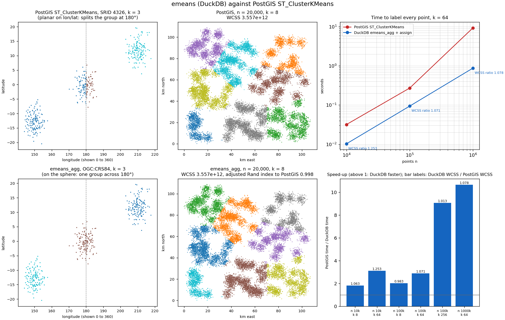

# emeans against PostGIS's ST_ClusterKMeans

Measured on 12 November 2026 on an Apple M5 Pro: PostgreSQL 18 with PostGIS 3.7.0 (GEOS 3.15, PROJ 9.9),
native arm64 from Homebrew, against DuckDB 2.0.0 on 8 threads. Reproduce with `make compare_postgis`
(`bench/compare_postgis.py`), which also writes the figure.

Each side labels every row. PostGIS: `ST_ClusterKMeans(geom, k) OVER ()`. DuckDB:
`emeans_assign_point(geom, (emeans_agg(geom, k) OVER ()).centroids)`. `emeans_agg` itself runs on one
thread (an aggregate has no bind step to read `emeans_threads`); the assignment uses DuckDB's threads.

## Behaviour

The same small inputs to both. The PostGIS documentation leaves most of these unstated, so this is
what each system did.

| case | PostGIS 3.7 | emeans | note |
|---|---|---|---|
| two separate pairs, k = 2 | the two pairs | the two pairs | same partition; PostGIS ids from 0, emeans from 1 |
| a NULL geometry | id -1 | NULL | PostGIS gives NULL and EMPTY the id -1 |
| POINT EMPTY | id -1 | NULL | |
| a polygon among points | clustered by its centroid | error: POINT geometries only | use `ST_Centroid(geom)` with emeans |
| k above the number of rows | error | error | both refuse |
| four identical points, k = 3 | one cluster | one cluster | |
| lon/lat points across 180°, SRID 4326 | split at 180° | one cluster across 180° | PostGIS treats lon/lat as planar; emeans clusters on the sphere |
| POINT Z, clusters apart only in z | uses z: two clusters | ignores z: one cluster | emeans is 2-D for geometries |
| POINT M, M as a weight | weighted | M ignored | emeans has no weights |
| the same input twice | same result | same result (same seed) | |
| the same rows in reverse order | a different partition | the same partition | emeans sorts the points first |

Not compared: PostGIS's `max_radius` (more clusters until none is wider than the radius), which emeans
does not have.

## Speed and quality

Gaussian blobs (128 centres in a 100 km square, 2 km spread) in projected metres (SWEREF99 TM range),
one partition, e-means with its defaults (5 epochs, seed 1234). WCSS is the within-cluster sum of
squares of each labelling, lower is better; the adjusted Rand index (ARI) is 1 when the two partitions
are the same.

| n | k | PostGIS | DuckDB | speed-up | WCSS DuckDB / PostGIS | ARI |
|---:|---:|---:|---:|---:|---:|---:|
| 10,000 | 8 | 0.01 s | 0.01 s | 1.8× | 1.063 | 0.592 |
| 10,000 | 64 | 0.03 s | 0.01 s | 3.1× | 1.253 | 0.705 |
| 100,000 | 8 | 0.09 s | 0.05 s | 2.0× | 0.983 | 0.734 |
| 100,000 | 64 | 0.27 s | 0.09 s | 2.9× | 1.071 | 0.745 |
| 100,000 | 256 | 2.05 s | 0.23 s | 9.1× | 1.013 | 0.575 |
| 1,000,000 | 64 | 9.34 s | 0.88 s | 10.6× | 1.078 | 0.691 |

DuckDB is 2× to 10× faster, more so as n and k grow. The quality is not uniformly as good: at k = 64
and 256 emeans's labelling has 1% to 25% more within-cluster variance than PostGIS's, and only at
n = 100,000, k = 8 is it better. The partitions differ (ARI 0.58 to 0.75) because on blobs that do not
match k there are many local optima and the two start differently. In the figure's 20,000-point case
(k = 8) the two partitions are essentially the same (ARI 0.998, equal WCSS).

Two reasons for the gap, both from the reference algorithm, not this port: e-means starts from k random
points, where k-means++ (as in most k-means implementations) spreads the start; and for d ≤ 2 the
reference turns dead-cluster revival off, which is what lets e-means escape poor starts in higher
dimensions. On the 16- to 1536-dimensional data of docs/BENCHMARK.md e-means matches or beats Lloyd.
More epochs do not close the gap: at n = 100,000, k = 64, nepochs 5, 10, 20 and 50 end 7%, 10%, 12% and
9% above PostGIS, which points at the start rather than the number of passes. A k-means++ start for
`emeans_agg` would be the change to try.
